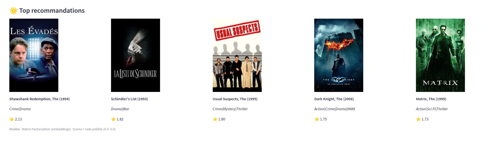

<h1 align="center">🍿 PopcornAI</h1>

<p align="center">
  <strong>Recommandation de films personnalisée par factorisation de matrices,<br/>
  entraînée sur les 32 millions de notes de MovieLens, avec une interface Streamlit et les affiches TMDb.</strong>
</p>

<p align="center">
  
  
  
  
  
  
</p>

---

Choisissez un utilisateur MovieLens, et PopcornAI vous propose les films qu'il a le plus de chances d'aimer,
avec leurs affiches.



## ✨ Fonctionnalités

- **🎯 Top-N personnalisé** : les films les mieux notés par le modèle pour un utilisateur donné (de 5 à 100).
- **🙈 Films déjà vus masqués** (optionnel), pour ne recommander que des découvertes.
- **🎭 Filtre par genre** et **🔍 recherche par titre**.
- **🎲 Suggestions au hasard**, pour sortir des sentiers battus.
- **🖼️ Affiches** récupérées via l'API TMDb, avec une image de remplacement si aucune n'est trouvée.

## 🧠 Comment ça marche

Chaque utilisateur et chaque film reçoit un **vecteur de 256 nombres** (*embedding*) et un **biais**.
La note prédite est le produit scalaire des deux vecteurs, plus les deux biais :

```text
note(u, f) ≈ ⟨vecteur_u , vecteur_f⟩ + biais_u + biais_f
```

| Étape | Détail |
|---|---|
| Données | `ratings.csv` de MovieLens 32M, identifiants réindexés |
| Découpage | 90 % entraînement / 10 % validation |
| Entraînement | Adam, perte MSE sur la note ramenée entre 0 et 1, précision mixte (AMP) sur GPU, batchs de 16 384 |
| Sélection | on garde l'époque avec le meilleur **RMSE** en validation |
| Artefacts | `artifacts/model.pt`, `mappings.pkl`, `config.json` |
| Prédiction | sigmoïde puis retour à l'échelle 0,5 – 5 (même transformation qu'à l'entraînement) |

## 🚀 Démarrage rapide

### Prérequis

- Python 3.10+, et idéalement un GPU (CUDA ou ROCm). Le `requirements.txt` vise PyTorch pour ROCm : retirez la
  ligne `--extra-index-url` si vous avez une carte NVIDIA.
- Le jeu de données [MovieLens 32M](https://grouplens.org/datasets/movielens/32m/), décompressé dans `ml-32m/`
- Une clé d'API [TMDb](https://www.themoviedb.org/settings/api) (gratuite) pour les affiches

### Installation et lancement

```bash
git clone https://github.com/DHoudetot-Cyril/PopcornAI.git
cd PopcornAI
python -m venv venv && source venv/bin/activate
pip install -r requirements.txt
echo "TMDB_API_KEY=votre_cle" > .env

python train.py --epochs 10 --factors 256   # entraîne et écrit artifacts/
streamlit run app.py                        # http://localhost:8501
```

> Pour un essai rapide : `python train.py --sample_frac 0.1` n'utilise que 10 % des notes.

## 📁 Structure du projet

```text
PopcornAI/
├── train.py          # chargement, entraînement, sauvegarde du meilleur modèle
├── app.py            # interface Streamlit + affiches TMDb
├── requirements.txt
├── ml-32m/           # dataset MovieLens (non versionné)
└── artifacts/        # modèle entraîné (non versionné)
```

## 🗺️ Pistes d'amélioration

- [ ] Mesurer la qualité du classement (Precision@k, NDCG) en plus du RMSE
- [ ] Gérer les nouveaux utilisateurs (*cold start*) à partir de quelques films choisis
- [ ] Servir le modèle via une petite API et mettre le tout dans Docker

## 👤 Auteur

**Cyril D'Houdetot** · [GitHub](https://github.com/DHoudetot-Cyril)

<sub>Données : MovieLens (GroupLens Research). Affiches : TMDb. Ce projet n'est ni approuvé ni certifié par TMDb.</sub>
